# NxRunner Design Guide

Wie Runner-Seiten in NxRunner aussehen und wie man sie baut. Die Vorlage ist die NxRunner-Oberfläche
([ui.html](../../nxrunner/resources/ui.html)) und das nweb-Layout von [bsnx.net/4.0](https://bsnx.net/4.0/w/)
(SB-Admin, dunkle Leisten).

> Diese Datei wird erzeugt. Text bearbeiten in `DesignGuide.template.md`, danach
> `python docs/design/build.py` ausführen. Das erzeugt auch alle Screenshots in `img/` neu.

## Grundsätze

NxRunner sieht aus wie ein Schaltschrank, nicht wie eine App: dunkel, kantig, beschriftet. Weiche Karten,
runde Buttons und bunte Kacheln, wie sie die meisten Admin-Oberflächen haben, gibt es hier nicht.

- **Anthrazit, nicht Schwarz.** Die Seite steht auf Tiefblau-Schwarz  `#12151b`, Karten heben sich mit  `#1b2029`
  nur leicht ab, Abschnitte liegen wieder eine Stufe tiefer. Die Kopfleiste ist das Schiefergrau  `#343a40`
  von bsnx.net und damit bewusst heller als die Seite: Sie ist der Deckel des Schranks. Links darin sind
  halbtransparentes Weiß und werden beim Darüberfahren heller.
- **Rechte Winkel, überall.** Keine abgerundete Ecke, auch nicht bei Buttons, Eingabefeldern oder Badges.
  Kein Schatten, kein Verlauf, keine Unschärfe. Tiefe entsteht nur durch Helligkeitsstufen und 1px-Linien
  in  `#2a303c`.
- **Ein Blau, sonst Grau.**  `#5b86ff` ist die einzige Farbe der Bedienung: Links, Hover-Kanten, die aktive Auswahl.
  Alles andere ist Grau zwischen  `#8b93a5` (Nebeninfo) und  `#e4e7ec` (Text). Wo Blau ist, kann man klicken.
- **Auswahl als voller Block.** Was gewählt ist, wird nicht unterstrichen oder mit einem Strich markiert, sondern
  komplett blau gefüllt, Schrift weiß. Man sieht aus dem Augenwinkel, wo man ist.
- **Status als Farbkante.** Meldungen tragen links eine kräftige 5px-Kante auf einer gedämpften Fläche:
  Blau  `#009` Info, Grün  `#090` Erfolg, Ocker 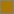 `#a70` Warnung, Rot  `#900` Fehler. Sie sind die einzigen hellen
  Flächen auf der Seite und deshalb nicht zu übersehen. Grün  `#3ecf7a` und Rot  `#ff6b6b` als Textfarbe gibt es
  nur für Zustände, nie zur Dekoration.
- **Umrandet statt gefüllt.** Badges und Buttons sind Rahmen mit Text, keine farbigen Pillen. Die Farbe steckt im
  Rahmen und in der Schrift, die Fläche bleibt dunkel. Gefüllt wird nur, was aktiv ist.
- **Beschriftet wie ein Gerät.** Kurze Wörter statt Sätze, Klassennamen und Pfade klein und grau unter dem Namen,
  Zwischentitel in Versalien mit Sperrung. Jeder Button sagt per Tooltip, was er auslöst.
- **Dicht gepackt.** Kleine Abstände, Tabellen statt Kacheln, kein Leerraum als Stilmittel. Eine Seite zeigt
  so viel wie möglich, ohne zu scrollen.
- **Feste Ordnung.** Oben die Leiste, links die Liste, rechts der Inhalt mit einer großen Überschrift und darunter
  Abschnitten. Das Menü des Runners steht immer am Ende als Reihe umrandeter Felder.

## Layout

### NxRunner

Oben eine feste Kopfzeile mit Titel, Statistik und Navigation. Darunter ein Raster aus der Runner-Liste
(280px) und dem Inhalt (`#content.card`). Unter 760px Breite stehen beide Spalten untereinander.

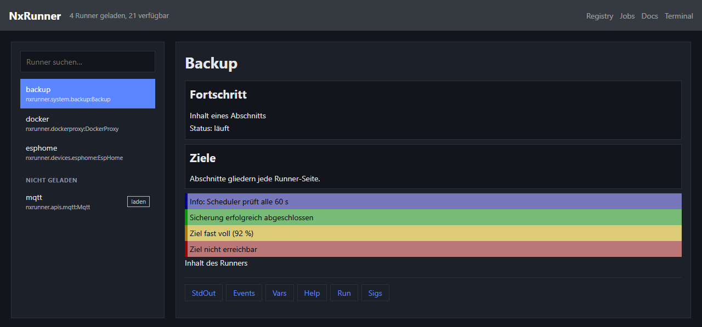

### bsnx.net 4.0

Kopfzeile  `#343a40`, Seitenleiste  `#212529`, Inhalt auf  `#333`, Karten  `#555`, Fußzeile  `#e9ecef`.
Runner-Inhalte nutzen dieselben Elemente, nur die Farbvariablen sind andere.

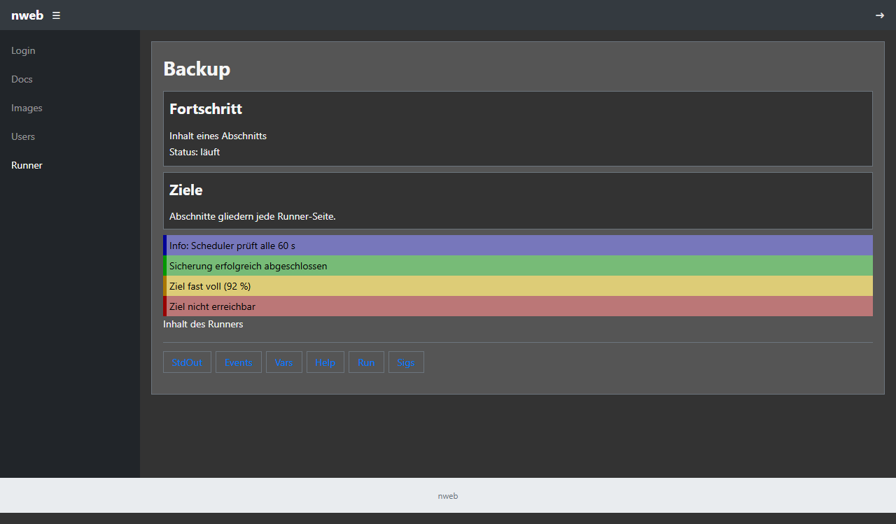

## Farben

| Variable | NxRunner | bsnx.net 4.0 | Verwendung |
|---|---|---|---|
| `--header-bg` |  `#343a40` |  `#343a40` | Kopfzeile |
| `--header-muted` | Weiß, 50 % | Weiß, 50 % | Links in der Kopfzeile |
| `--bg` |  `#12151b` |  `#333333` | Seite, Sections, Hover |
| `--panel` |  `#1b2029` |  `#555555` | Karten, Eingabefelder |
| `--text` |  `#e4e7ec` |  `#dfdfdf` | Text |
| `--muted` |  `#8b93a5` |  `#adb5bd` | Hinweise, Klassennamen |
| `--border` |  `#2a303c` |  `#6c757d` | Rahmen, Trenner |
| `--accent` |  `#5b86ff` |  `#007bff` | Links, aktive Auswahl |
| `--ok` |  `#3ecf7a` |  `#28a745` | Erfolg |
| `--err` |  `#ff6b6b` |  `#dc3545` | Fehler |
| `--code` |  `#151920` |  `#2b2b2b` | `pre`, JSON |

Meldungen (`alert_*`) haben feste Farben, weil sie mit Inline-Styles aus `nwebclient.web` kommen:
Info  `#009`/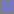 `#77b`, Erfolg  `#090`/ `#7b7`, Warnung  `#a70`/ `#dc7`, Fehler  `#900`/ `#b77` (Rand/Fläche).

## Abstände

| Wert | Verwendung |
|---|---|
| 0 | Sections seitlich: bündig mit Überschrift und Meldungen |
| 4px | Formularzeilen, Meldungen innen |
| 8px | Sections innen und untereinander, Abstand zwischen Badges/Buttons |
| 12px | Abstand unter Überschriften, Navigation |
| 16px | Karten innen, Kopfzeile seitlich |
| 20px | Raster der Hauptseite |

## Elemente

Jedes Beispiel unten ist genau der Code, mit dem der Screenshot darunter gerendert wurde
(Methode `part_*(self, p: b.Page, params={})` im Runner, `from nwebclient import base as b, web as w`).

### Typografie

```python
p.h1("Backup")
p.h2("Quellen")
p.p("Fließtext in 14px system-ui, Zeilenhöhe 1.5. Hinweise werden mit "
    "<span class='muted'>.muted</span> abgeschwächt.")
p.h3("Unterüberschrift")
```

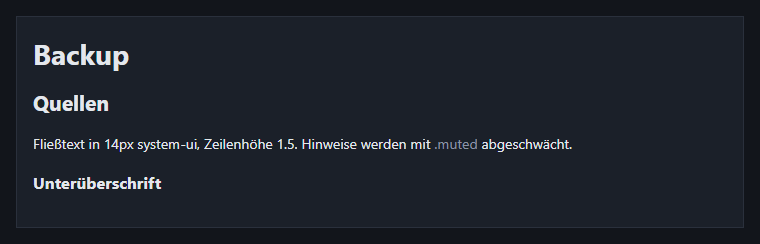

### p.section

```python
with p.section(h="Fortschritt"):
    p.div("Inhalt eines Abschnitts")
    p.prop("Status", "läuft")
with p.section(h="Ziele"):
    p.div("Abschnitte gliedern jede Runner-Seite.")
```

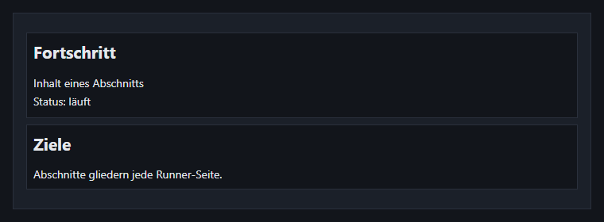

### p.expandable

```python
with p.expandable("Erweitert", expanded=True):
    p.div("Aufgeklappter Inhalt, ohne JavaScript (&lt;details&gt;)")
with p.expandable("Protokoll", expanded=False):
    p.div("verborgen")
```

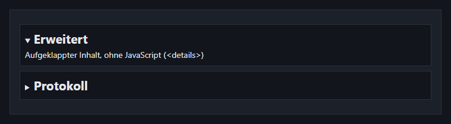

### p.prop

```python
p.prop("Version", "1.4.2")
p.prop("Laufzeit", "3 h 12 min")
p.prop("Ziele", ["nas", "s3"])
```

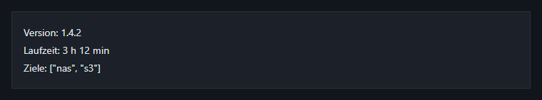

### Formulare

```python
p('<form method="post">')
p.form_input('name', "Name", hint="Anzeigename der Quelle", value="Fotos")
p.form_select('kind', "Art", {'dir': "Verzeichnis", 'mysql': "MySQL"}, value='dir',
              hint="Art der Quelle")
p.form_input('interval_s', "Intervall (s)", hint="0 = nur manuell", type='number', value=3600)
p.form_elem(w.tag("input", "", type="submit", value="Speichern", title="Quelle speichern"))
p('</form>')
```

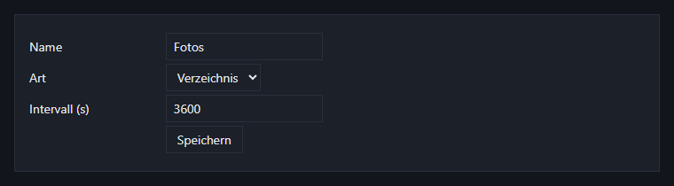

### Buttons & Links

```python
p.div(w.button_js("Jetzt sichern", "", hint="Startet die Sicherung sofort") + ' '
      + w.button_js("Prüfen", "", hint="Ziel auf Erreichbarkeit prüfen") + ' '
      + w.a("Fällige Sicherungen", "#", hint="Liste der fälligen Sicherungen"))
```

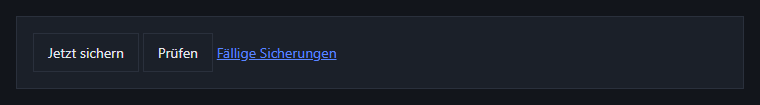

### Meldungen

```python
p.alert_info("Info: Scheduler prüft alle 60 s")
p.alert_success("Sicherung erfolgreich abgeschlossen")
p.alert_warn("Ziel fast voll (92 %)")
p.alert_error("Ziel nicht erreichbar")
```

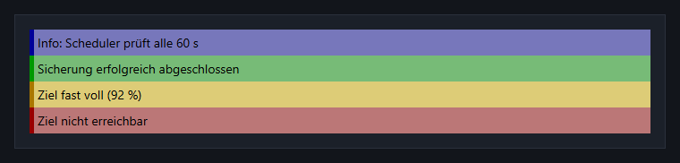

### p.grid

```python
rows = [{'name': "Fotos", 'kind': "Verzeichnis", 'size': "12,4 GB"},
        {'name': "Wiki", 'kind': "MySQL", 'size': "380 MB"},
        {'name': "Mail", 'kind': "IMAP", 'size': "2,1 GB"}]
p.grid(rows, [w.Grid.col('name', "Name"), w.Grid.col('kind', "Art"), w.Grid.col('size', "Größe")],
       {}, search=True)
```

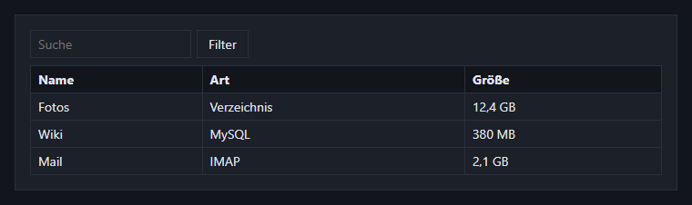

### p.pre

```python
p.pre({'success': True, 'value': ["Fotos", "Wiki"], 'duration': 1.42})
```

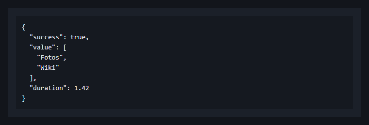

### Listen & Trenner

```python
p.ul([w.a("Quellen", "#", hint="Alle Quellen"), w.a("Ziele", "#", hint="Alle Ziele"), "Protokoll"])
p.hr()
p.right(w.a("Weiter &raquo;", "#", hint="Nächste Seite"))
```

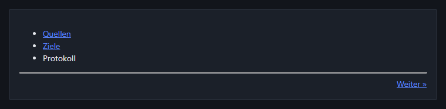

### Badges & Chips

```python
p.div('<span class="badge">laden</span> <span class="badge tag">tag</span> '
      '<span class="badge ok">ok</span> <span class="badge warn">fehler</span>')
p.div('<span class="chip active">alle</span> <span class="chip">system</span> '
      '<span class="chip">devices</span>', style='margin-top: 8px')
```

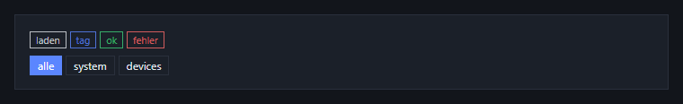

### Runner-Menü (nx_menu)

```python
p.div("Inhalt des Runners")
p('<ul class="nx_menu">' + ''.join(f'<li><a href="#" title="{t}">{t}</a></li>'
                                   for t in ["StdOut", "Events", "Vars", "Help", "Run", "Sigs"]) + '</ul>')
```

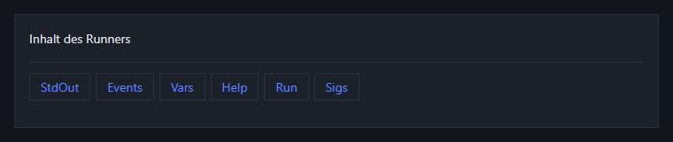


## Seitenaufbau eines Runners

```python
def part_index(self, p: b.Page, params={}):
    p.h1("Backup")
    p.div(w.a("Fällige Sicherungen", self.link_due(), hint="Liste der fälligen Sicherungen"))
    with p.section(h="Quellen"):
        p.grid(sources, cols, params, empty="Noch keine Quellen.", prefix='s_')
    with p.section(h="Neue Quelle"):
        p.form_input('name', "Name", hint="Anzeigename")
        p.form_elem(w.tag("input", "", type="submit", value="Anlegen", title="Quelle anlegen"))
```

- Genau ein `p.h1` pro Seite, Gliederung mit `p.section(h=...)`. Selten Gebrauchtes in `p.expandable(..., expanded=False)`.
- Tabellen immer mit `p.grid`, damit Sortierung, Suche und Seiten überall gleich funktionieren.
- Einzelwerte mit `p.prop`, Rohdaten mit `p.pre` (dicts werden als JSON formatiert).
- Rückmeldungen mit `p.alert_*`, nicht mit eigenen farbigen `div`s.
- Nutzereingaben in HTML mit `w.s(...)` maskieren.
- Das Runner-Menü (`nx_menu`) hängt NxRunner selbst an. Der Runner rendert es nicht.
- Methoden kurz halten (max. 50 Zeilen). Große Seiten in mehrere `part_*`-Hilfsmethoden aufteilen.
